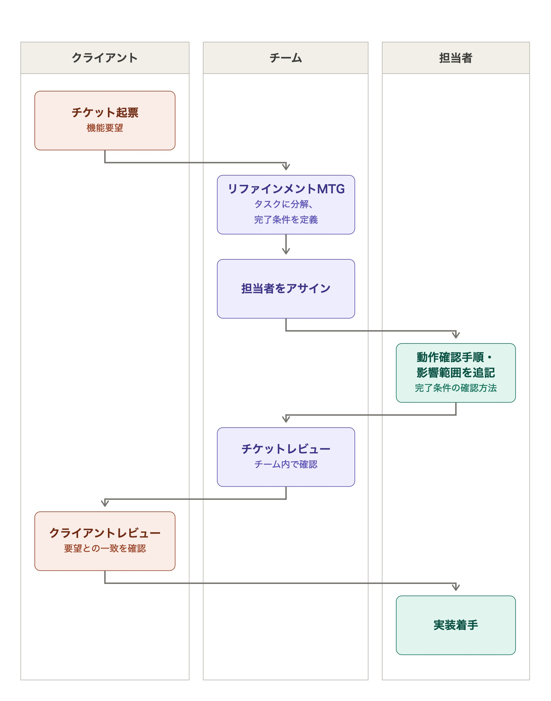

<div class="doc-header">
  <div class="doc-title">チームにシフトレフトを持ち込んだが上手くいかなかった話</div>
  <div class="doc-author">井上智也（だっしー）</div>
</div>

# チームにシフトレフトを持ち込んだが上手くいかなかった話

<!--
この記事の主張（一文）:
  シフトレフトを持ち込もうとして、筆者が作ったのはフィードバックループではなく「関門」だった。
  早く学ぶための実践を、早く確定させる仕組みとして実装してしまった。

全体の分量: 7〜8 ページ想定（A5 / 本文 1 ページあたり約 1,000 字）
強制改ページが必要なときは <hr class="page-break"/> を使う。
-->

## はじめに

開発プロセスの最後の方になって出てくる考慮漏れに悩まされていませんか。

筆者も直面していたこの課題について、「シフトレフト」の考えを持ち込んで挑みました。

ISTQB によると、シフトレフトとは「テストおよび品質保証の活動の実施を、ソフトウェア開発ライフサイクル内で可能な限り早く行うためのテストアプローチ」とされています<span class="footnote">https://glossary.istqb.org/ja_JP/term/-34</span>。

ソフトウェア開発ライフサイクルが左から右へ流れるとすると、 *要件定義→設計→実装→テスト→リリース→運用* といった形になるでしょう。「実装が終わったらテストをする」というのが一般的だとすれば、シフトレフトを導入する現場では、「実装が終わる前（最中）のテスト」「設計のテスト<span class="footnote">なおここでいう「テスト」は、でき上がったソフトウェアを動かして検証することに留まらず、レビューもテストの一部と見なします。「設計をテストする」はピンとこなくても、「設計をレビューする」と聞くと、普段からやられている方も多いのではないでしょうか。</span>」「要件定義のテスト」というものを行います。テストの段階を左にズラすので、シフトレフトといいます。

ただし筆者の解釈では、シフトレフトは各フェーズで厳密にテストし、手戻りを無くす、といったウォーターフォール的な発想とも異なります。筆者が目指したのはアジャイルの思想である「早く経験する、経験から学ぶ」です。効果的に取り入れられれば、欠陥の早期発見、素早い改善サイクルに繋がります。

筆者はチームの開発プロセスにシフトレフトを簡単に組み込む方法として「実装作業の前に作業内容チケットを書き、レビューを受ける」というルールを制定しました。

しかし、これは想定外に難航し、最終的には撤廃しました。その後は体制変更があって筆者はチームを離れることになりました。

ここでは、その経験から学んだことを語らせてください。

## 筆者の取り組み

### 改善開始前

筆者のプロジェクトでは、品質に課題を抱えていました。

コードは可読性が高く、担当者が想定した仕様やケースに対する自動テストは書かれていました。ただし QA テスト中やリリース後に担当者の認識ズレや想定外のパターンが発覚し、不具合、障害に陥ることが頻繁にありました。過去にチームとしては経験していた落とし穴に、違う担当者がまた落ちる、ということも起きていました。

チームが担当するのは 5 つのコンポーネントをもつモジュラモノリスな Web API であり、さらに連携対象の外部サービス、Web フロント、ネイティブアプリまで含めると、全容を把握するのは非常に困難でした。それだけでなくメンバーはそれぞれ別々の機能を開発しており、プルリクが上がってくるまで隣のメンバーが何をしているのかほとんど把握していない、という体制でした。

この体制を極力平準化していくため、前チームリーダーによって作成されたチケットレビューのルールがありました。その形は図 1 に示します。



このルールにおいて、原則として「チケット記入が先、実装はその後」です。ただし実態としては先に実装に取り組み、プルリクを出してからチケットを後追いで間に合わせていました。そのため、チームレビューの段階で設計に対する指摘をしても、致命的な問題でなければ採用されにくい力学が働いていました。

このような体制だったため、プルリクが上がってからコードの詳細についての議論は活発でしたが、設計レイヤー、業務レイヤーについての議論は乏しくなりがちでした。

### チケットを必ず書くというルール

チームの品質に対する意識は決して低くはありませんでしたが、ソースコードレビューに比重が偏りすぎていると考えました。チームには「もっと実装前段階からの検証に力を入れたい」と訴えました。具体的には、「設計段階で、リリース前に必要なテストについて考えて欲しい」「実装を始める前から、運用中に起きたら困るパターンについて考えて欲しい」と伝えました。

最初は Design Doc を書くことを検討していたのですが、仕事は増やしたくありませんでした。また実現したい目的は設計段階での検証であり、ドキュメントを揃えることは重視していませんでした。

そこで、開発チケットに軽量な Design Doc を書くことと、**チケットの記載が終わるまで実装を進めてはいけない**ことをルールにしました。従来やっていたことを拡張するだけなので、負担は少ないと考えたのです。チケットテンプレートも少し修正し、 Design Doc に寄せました。

```PlainText
## 完了条件
// As-Is,To-Beで書くか、To-Be状態をGiven,When,Thenで書く
// 将来的にはAIがこれを読んで自動テストを書ける所までを期待する

## 対応方針
// どうやって完了条件を満たすのか、簡潔にまとめる

## 影響範囲
// API, 画面, 業務影響も含めて記載する

## 動作確認手順
// 開発者が行う手動テスト内容について記入する
// QAチームだと実施が難しい、DBに異常値を入れる場合のテスト等も検討する

## QA依頼内容
// QAチームに依頼するテスト範囲について記入する
// 影響範囲を踏まえて「◯◯にデグレがない事は見て欲しい」といった大枠の依頼を書く
```

## メンバーからの反応と、そこから考えたこと

### 「実装してみないと分からない」

運用を始めてすぐ、当初想定していた以上に「チケットを書くのが難しいので待って欲しい」といわれました。筆者としては「難しい」ことは無く、事前に考える時間を取るかどうかの違いしかないと考えていたので、これは予想外でした。なかなかチケットレビューは進まず、一方でプルリクの方は変わらず上がってきました。

当初は慣れが解決することを期待しましたが、その状態が数スプリント続いたため、特にプルリクが先行することが多かったメンバーにヒアリングをしてみました。出てきたコメントは筆者にとって驚くべきものでした。

- 全部出揃っていないとチケットレビューに出せない
- チケットレビュー後に変更が効かないから実装者としては後に回したくなる
- チケットがウォーターフォール的になっている

特に、ウォーターフォールであるというコメントは衝撃的でした。筆者がシフトレフトを重視するのは、むしろアジャイルのプラクティスとして、経験から学び、修正をするためでした。チケットレビューで承認を受けたとしても、実装から追加のフィードバックが得られたのであれば当然これを受けて、チケットの記述も変化するものだと考えていました。

ただし実際には、チームレビューだけでなくクライアントレビューまで通したあとで対応方針を変更するのは、再説明・再承認・待ち時間のコストから避けたいと感じて当然でした。結果として「チケットレビューで決めたらその後は変えられない」という思考になっていました。

筆者のチームにおいて、チケットの完了条件は 1 度作成されたら**不変**です。変化があるとすればそれは新しいチケットが切られるべきです。一方で、完了条件をどう達成するかは、作業完了までに受けるさまざまなフィードバックによって**可変**です。筆者は可変のものだけ切り出した Design Doc を別に書く負荷を嫌って、不変のものと可変のものとを同じ場所に書かせるというミスを犯していました。

言い換えると、早期にフィードバックを受けて改善していくプロセスを作ろうとして、早期に**決めて**手戻りを許さないプロセスにしてしまったのです。少なくとも、承認フローを維持したまま Design Doc をチケットに統合するやり方は筋のよくないものでした。

### 「プルリクに書けばよくないか」

別のメンバーからは、「技術的なことを自然言語で説明して情報量を落とすより、プルリクを見てもらうべき」という指摘も上がりました。

これは事前にプルリクができ上がっているからだ、とは思いました。ただこの当時は Claude の進化が目覚ましく、人間が自然言語でチケットを書くより、LLM がプルリクを仕上げる方が早いという逆転現象も起きていました。短い時間で大量に試行錯誤できるのなら、試した中でもっとも良かった方法 1 つをレビューに持っていくのは道理に合っています。

シフトレフトが不要になった、とは考えませんでした。たとえば QA テストしてから課題に気付いたとしたら、コードはすぐ直せてもテストはやり直しになります。

ただ、実装着手前に検査することにはこだわらずともよく、**検査は実装と両輪で回していくべき**であると考え始めました。

また、動くコードでコミュニケーションできるのならば、少なくともエンジニア同士であればそちらの方が認識齟齬は起きにくいのも、プルリクベースで会話する利点でした。

逆にチケットは非技術者も読むものであり、どうしても技術のみの話題がしにくい環境でした。このこともまた、Design Doc をチケットに統合することの筋の悪さを示しています。

### 「軽いタスクに取り組むのに腰が重い」

これは筆者自身の経験です。

ある日、筆者は変数の typo をみつけて修正しようとしました。修正は一瞬で済むもので、コンパイルと自動テスト以上のテストは不要と断言できるものでしたが、チームのルールとしてはチケットを書き、レビューを通す必要がありました。

軽微な修正に腰を重く感じさせてしまうルールは、少なくともアジャイルの精神には反している、と確信を持った瞬間でした。

## 次の形

最終的には冒頭に書いたとおり、チケットレビューを先回しにする、というルールは撤廃しました。

シフトレフトの試みとしては引き続き、重要な設計判断についてはチケットとは別に ADR<span class="footnote">Architecture Decision Record, アーキテクチャ上の重要な決定について説明する文書。</span>を書き、これをチームでレビューするようにしました。

ADR の導入はチケットでの反省点を踏まえて、次のようにしました。

| チケットでの反省点 | 対応 |
| --- | --- |
| レビューを経て決まったことは変更しづらい | クライアントレビューの対象にしない<br/> 実装してみた結果が芳しくなければ違うオプションを採用し直してもよい |
| エンジニア以外も読むため、技術用語を使わずに書かなければならない | 読者をエンジニアに絞った<br/> コードも技術用語も何でも使ってよい |
| 実装前に書き切ることに固着した | <!-- textlint-disable -->両輪で回すという考え方に沿って、実装が先行してもよい<!-- textlint-enable --> |

ADR を導入してよかったと感じた印象的な事例があります。サービスに新しい外部サービスとの繋ぎ込みが必要になった際、チームの管轄するバックエンドが中継するのか、それとも Web フロントエンドが直接繋ぐのか、を検討した ADR です。

機能の拡張性、再利用性、責務分割とさまざまな観点からの比較は甲乙つけがたく、チームの意見もきれいに二分され、他チームも巻き込んだ活発な議論になりました。最終的には担当者がベストだと考えていたオプションとは違うものがより優れた方法だと結論され、実装に移りました。

この議論が上手くいった要因は、チケットでの反省点を踏まえていたことはもちろんですが、設計を目的とした純粋なドキュメントであり、他の目的による制約を受けていないことにあったと考えています<span class="footnote">チケットには「hoge を実現するために fuga をします」と書きますが、ADR には「hoge を実現するための fuga, piyo の方法を比較する」と書きます。</span>。フォーマットとして毎回 ADR が向いているかはともかく、シフトレフトの手段としてチケットともコードとも別に、独立した設計ドキュメントを書いていくのは間違いなく有効でした。

ただし、課題もあります。議論するほどもないと見なされたタスクにはそもそもドキュメントが用意されないのです。そして「見落とし」とは、わざわざ議論するまでもないと見なされるような、警戒していないタスクにこそ潜むものです。かといって「すべてのタスクにはドキュメントを書く」というルールは、コスト的に現実的ではありません。

このコストの問題が、チケットを使ってシフトレフトを適用しようと考えた理由でした。省コストで見落としを探す仕組みは、今回の取り組みでは構築できませんでした。

## 学んだことと宿題

筆者の学びは、おおむね次に集約されました。

- 「早く学ぶ」と「早く決める」を取り違えず、判断は最後まで可変に保つこと
- 実装前の検証にこだわらず、両輪で回していくこと
- チームメンバーの作業コスト、心理的ハードルに留意すること
- アジリティが犠牲になっていないか注意深く観察すること

宿題は、担当者がリスクに気付いていない状態で、どうすれば問題の早期発見と省コストを両立できるかです。

<!-- textlint-disable -->
振り返ってみると、シフトレフトというより、チームにおける運用の仕方を考えることが多かったです。単にシフトレフトを概念として持ち込むだけでは不十分で、チームの実態に沿うように運用設計する必要があるということが、最も大きい学びでした。
<!-- textlint-enable -->

この体験談が、読者のチームの課題を改善する一助になると幸いです。
