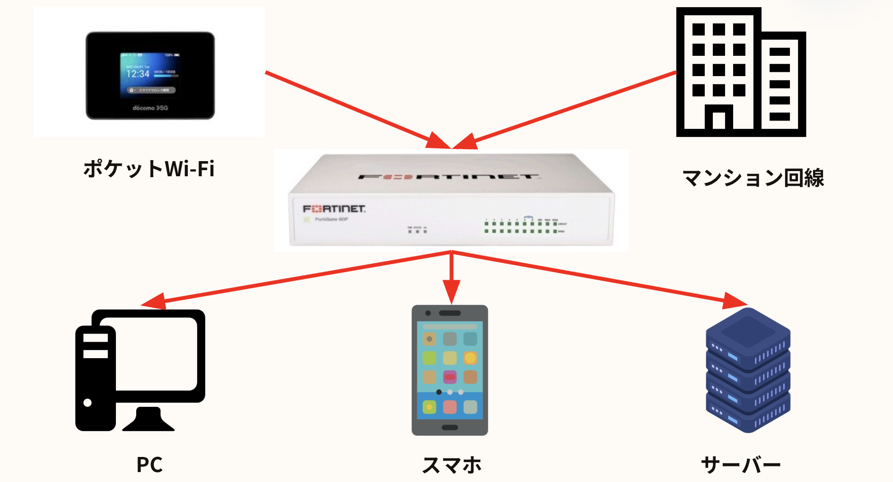
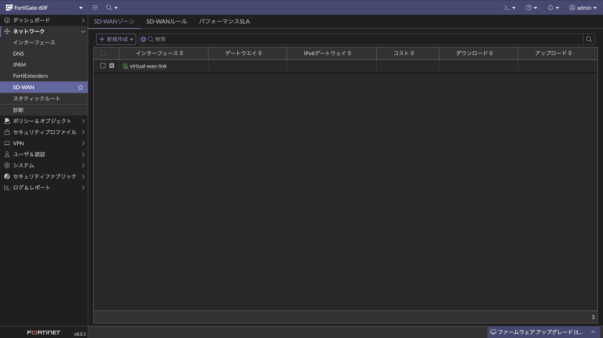
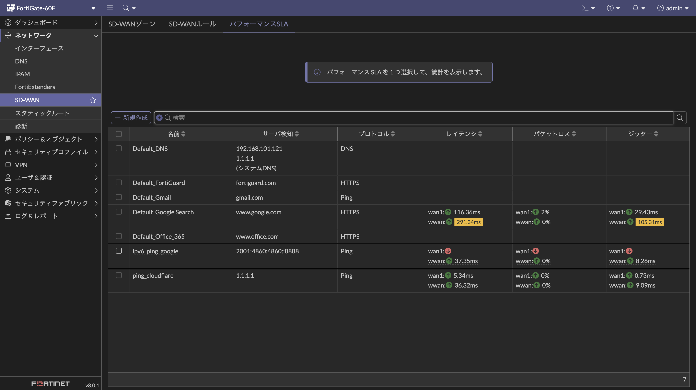
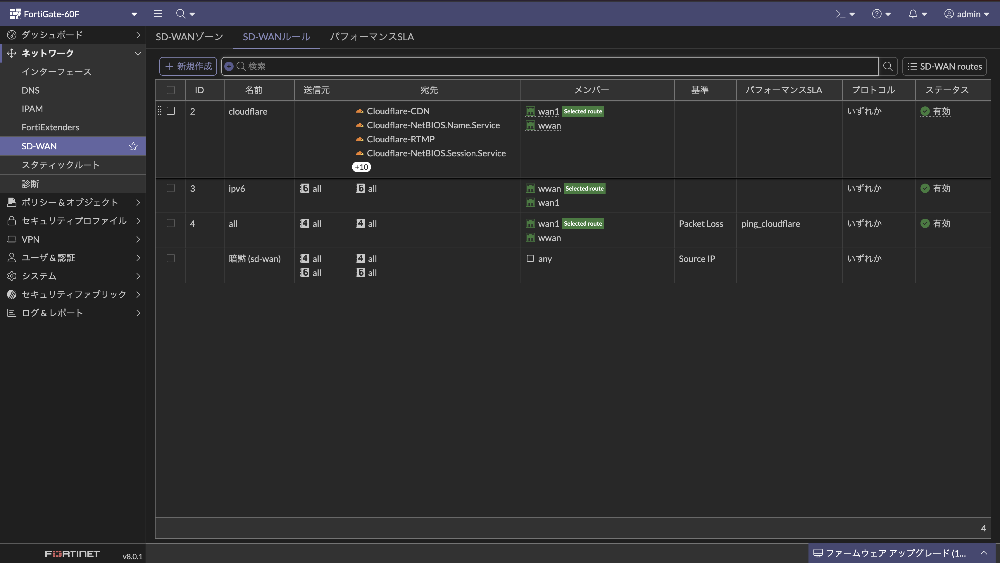
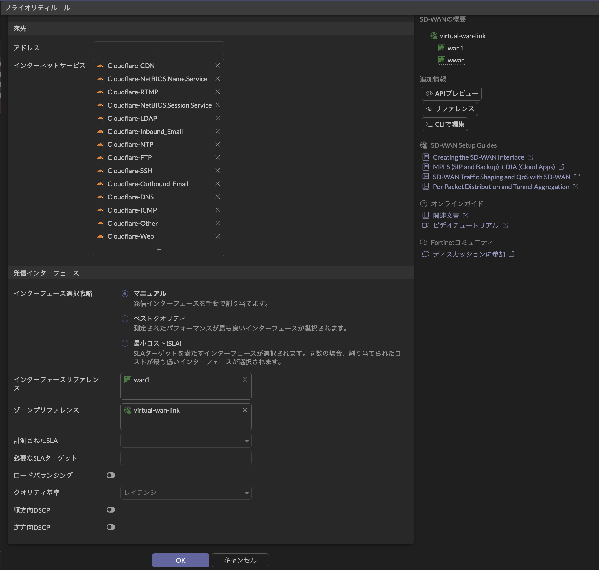
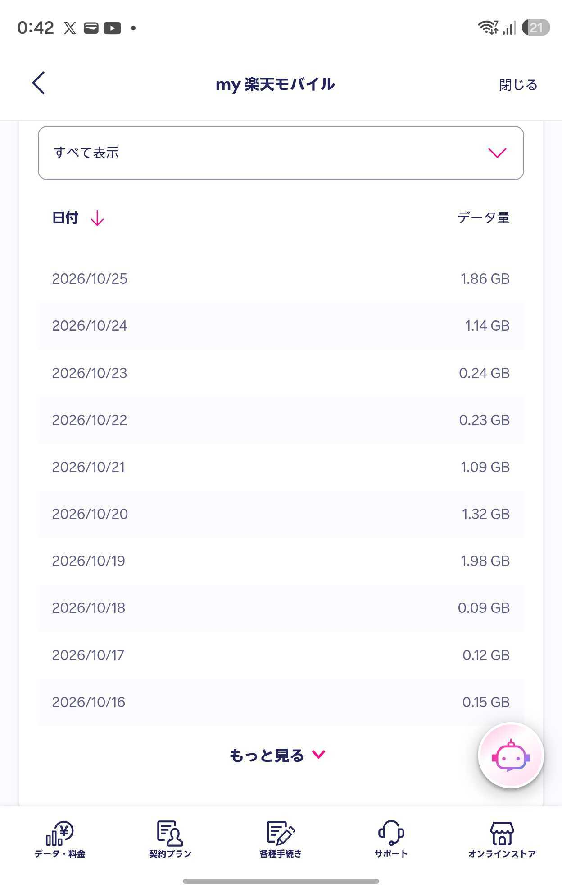
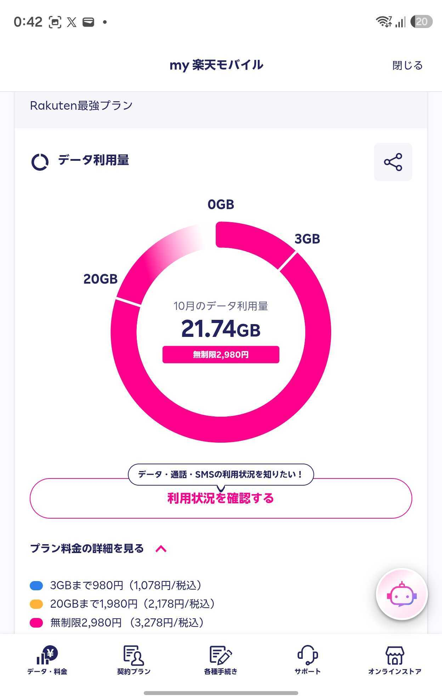

  
家のよわよわ回線をLTE回線とSD-WANを用いてロードバランスさせちょっとだけ安定させよう

  
はるちろ（牧野）

# 家のよわよわ回線をLTE回線とSD-WANを用いてロードバランスさせちょっとだけ安定させよう

## はじめに

皆さん、お家では満足できる品質の回線を引けていますでしょうか？
自分の家では、マンションに付属している無料の回線を使って、日々開発やサーバーの運営をしています。
速度は平均100Mbps程度出ているため、普段使いでは基本的に困らないのですが、21時〜24時あたりは混雑するためか通信品質が安定せず、まったく繋がらないときもありました。
そこで、光回線を個別に引けないかマンションの管理会社にお願いしてみたのですが、断られてしまい工事をしてもらえませんでした。
この章では、工事をせずにできる限りネット回線を安定させる方法をまとめてみたいと思います。
具体的には、マンション回線に加えてポケットWi-Fi（楽天モバイルのLTE回線）を用意し、FortiGateというルーターのSD-WAN機能を使って2つの回線をロードバランスさせます。
通信の概要図を以下に載せます。

{style="width: 75%"}

また、この内容は2025/05/15に開催されたきたく.dev #2でのLT「神（管理会社）に光あれといったしかし光は来なかった...」の続きです[^kitaku-lt]。
そもそも回線がなぜ遅くなっているのか、サブ回線にStarlinkやテレビ回線ではなくLTE回線を選んだのはなぜか、といった詳しい背景は、ぜひこちらのスライドを見ていただけると嬉しいです。
かなり面白く書いたつもりですので、クスッと笑っていただけると幸いです。

{style="width: 75%"}

[^kitaku-lt]: きたく.dev #2「神（管理会社）に光あれといったしかし光は来なかった...」 https://speakerdeck.com/harutiro/mansiyonbei-efu-kenonetutowakutoltehui-xian-wozu-mihe-waseta-netutowakunoan-ding-hua-nokao-an

## SD-WANとは

SD-WAN（Software-Defined WAN）は、ざっくり言うとSDNの考え方をWANに持ち込んで、拠点間やクラウドへの接続をソフトウェアで柔軟に制御しよう、という技術です[^fortinet-sdwan]。
これまでのWANは、拠点ごとにルーターを1台ずつ設定して、専用線を中心に組むのが一般的でした。
一方SD-WANでは、専用線・ブロードバンド・モバイル回線など、種類もキャリアもバラバラな物理回線を束ねて、その上に仮想的なネットワークを作ります。
そのおかげで、アプリケーションや宛先ごとの経路制御、複数回線へのロードバランス、帯域制御などをまとめて管理できるようになっています。
本来は企業の拠点向けの仕組みですが、今回はこれをお家に持ち込んで、マンション回線とLTE回線を束ねてロードバランスさせ、混雑する時間帯の不安定さをなんとか和らげてみたいと思います。

[^fortinet-sdwan]: フォーティネット「SD-WANとは？」 https://www.fortinet.com/jp/resources/cyberglossary/sd-wan

## 設定方法

ここでは細かい手順というより、FortiGateでSD-WANを動かすまでの大まかな流れを紹介していきます。
詳しい画面操作は、フォーティネットの設定ガイド[^fortinet-sdwan-guide]がとても参考になります。
やる内容は大きく分けて「SD-WANゾーンの作成」「パフォーマンスSLAの設定」「SD-WANルールの設定」「ファイアウォールポリシーの設定」の4つです。

[^fortinet-sdwan-guide]: フォーティネット「FortiOS 7.2 セキュアSD-WAN設定ガイド」 https://www.fortinet.com/content/dam/fortinet/assets/deployment-guides/ja_jp/fos72_sdwan_deploy_guide.pdf

### SD-WANゾーンの作成

まずは、束ねたい回線をまとめておく入れ物として、SD-WANゾーンを作ります。
`ネットワーク > SD-WAN` の「SD-WANゾーン」タブで「新規作成 > SD-WANゾーン」を選び、好きな名前でゾーンを作っておきます。
次に、同じタブの「新規作成 > SD-WANメンバー」から、マンション回線とLTE回線をつないだインターフェースを、それぞれ先ほど作ったゾーンのメンバーとして追加します。
このとき、メンバーごとにゲートウェイも忘れずに指定しておきます。
あわせて、デフォルトルート（`0.0.0.0/0`）の宛先をこのSD-WANゾーンに向けておくと、外向きの通信がSD-WANを通るようになります。

{style="width: 75%"}

### パフォーマンスSLAの設定

続いて、各回線の品質をチェックしてくれるパフォーマンスSLAを設定します。
これは、各回線から指定したサーバーへ定期的にpingやHTTPのプローブを飛ばして、遅延・ジッター・パケットロスを測ってくれる機能です。
しきい値（SLAターゲット）を決めておくと、条件を満たさなくなった回線を経路から外して、もう片方の回線へ逃がしてくれます。
夜の混雑で遅くなったマンション回線を自動で避けてもらうには、ここの設定が大事になってきます。

{style="width: 75%"}

### SD-WANルールの設定

SD-WANルールでは、どの通信をどの回線に流すかを決めます。
ルールは上から順番に評価されて、どれにも当てはまらない通信には暗黙のルールが適用されます。
ルールごとに、回線を固定する「マニュアル」や、品質のよい回線を選んでくれる「ベストクオリティ」などの戦略を選べます。

ここで気をつけたいのが、通信ごとに送信元のグローバルIPが変わると困るサービスです。
セッション単位でロードバランスすると、同じサービスへの通信でも回線が振り分けられてしまい、相手から見える送信元IPが途中で変わってしまいます。
Cloudflare（Cloudflare TunnelやAccessなど）やMicrosoft 365のログイン周りは、こうしたIPの変化で認証が切れたり接続が不安定になったりしがちです。
なので、これらのサービスは宛先を指定して、「マニュアル」で片方の回線に寄せるルールを上のほうに置いておくと安定しやすいと思います。

{style="width: 75%"}

{style="width: 75%"}

### ファイアウォールポリシーの設定

最後に、LAN側からSD-WANへ通信を通すためのファイアウォールポリシーを作ります。
着信インターフェースをLAN側、発信インターフェースを先ほど作ったSD-WANゾーンにして、NATを有効にします。
NATは発信インターフェースのアドレスを使う設定にしておくと、出ていく回線に合わせて送信元アドレスを変換してくれます。
これで、家の中の端末からの通信がSD-WANを通って、2つの回線に振り分けられるようになりました。

## 実際に設定してみた体感

ここでは、SD-WANを設定してしばらく使ってみた体感をまとめます。
まず、混雑しやすい21時〜24時の時間帯でも、マンション回線が詰まったときにLTE回線へ逃がせるようになったため、通信が安定しているように感じました。
ただし、LTE回線はマンション回線よりも速度が出ないため、LTE回線に逃げている間は、接続は保たれているものの速度が落ちたように感じました。
また、回線が切り替わるタイミングではセッションが切れるため、接続先が変化したと体感する場面がときどきありました。

次に、実際にどの程度LTE回線が使われているのかを、楽天モバイルの通信量から確認してみました。
1日あたりの通信量は0.2GB〜1.5GB程度で、1ヶ月間の合計は約20GBでした。
これらのデータから、ある程度の通信がLTE回線に流れているとわかりました。

{style="width: 40%"}

{style="width: 40%"}

## 終わりに

今回は、工事ができない環境でもできる限りネット回線を安定させるために、マンション回線とLTE回線を用意して、FortiGateのSD-WAN機能でロードバランスさせてみました。
ただ、回線品質を数値で計測できていないため、品質の評価は体感ベースになってしまいました。
次にネットワークについてまとめる機会があれば、pingやジッターなどを計測して、どの時間帯にどれくらい回線が詰まっているのか、どの程度解消したのかを記録できたらと思っています。
ほかにも、このSD-WANを使うと、IPv6が割り当てられない環境でもLTE回線側から無理やり引っ張ってくるといった裏技的な使い方もできるので、それはまた別の機会にお話しできたらと思います。
