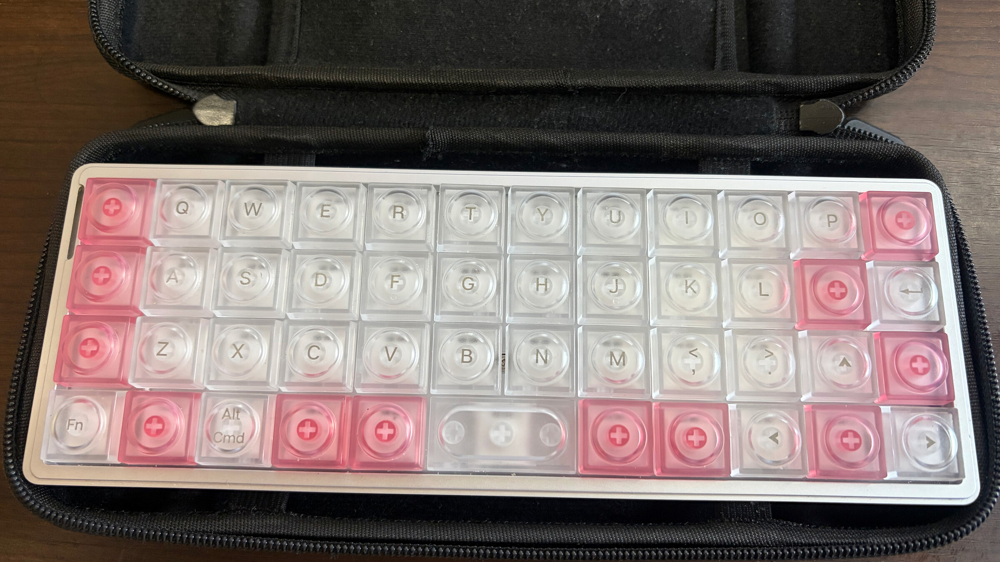
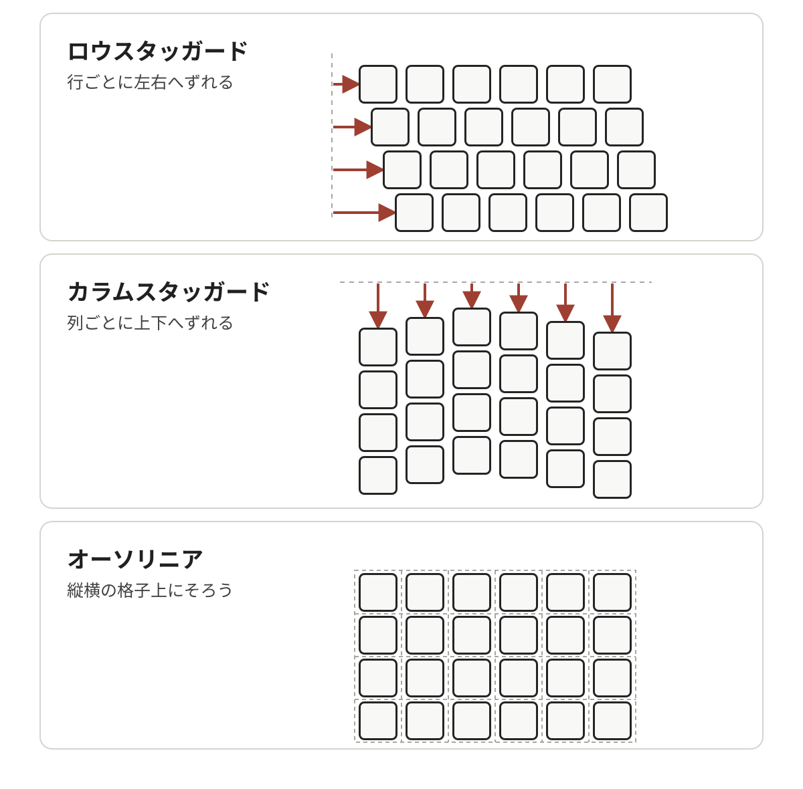
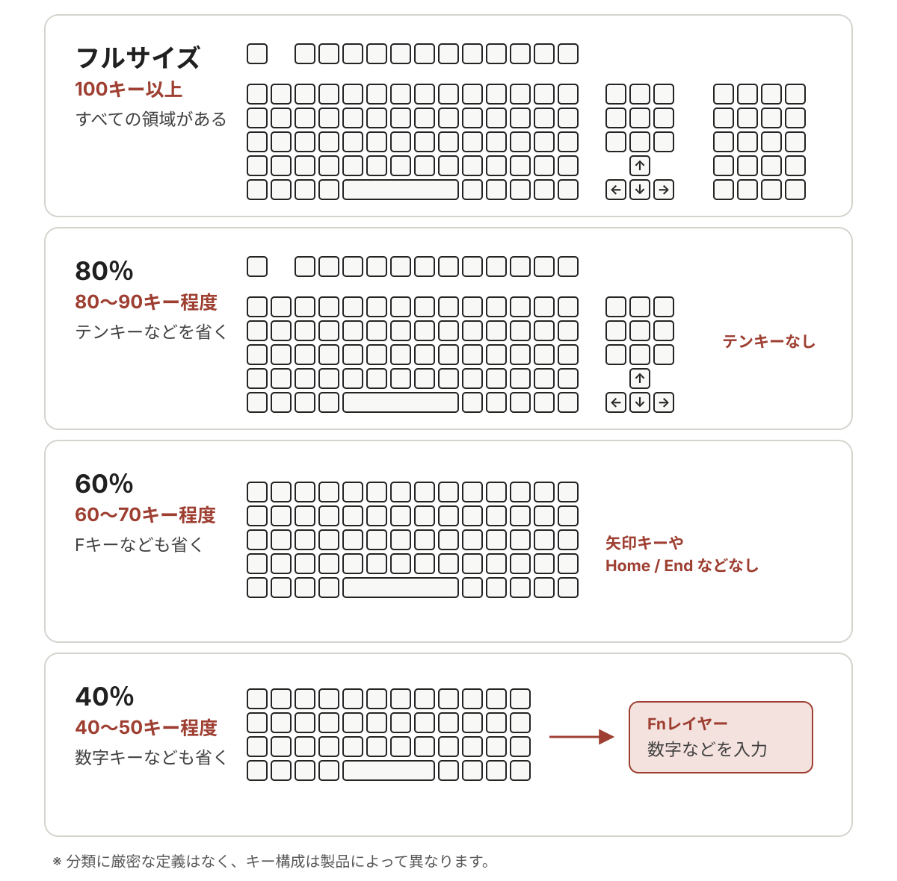
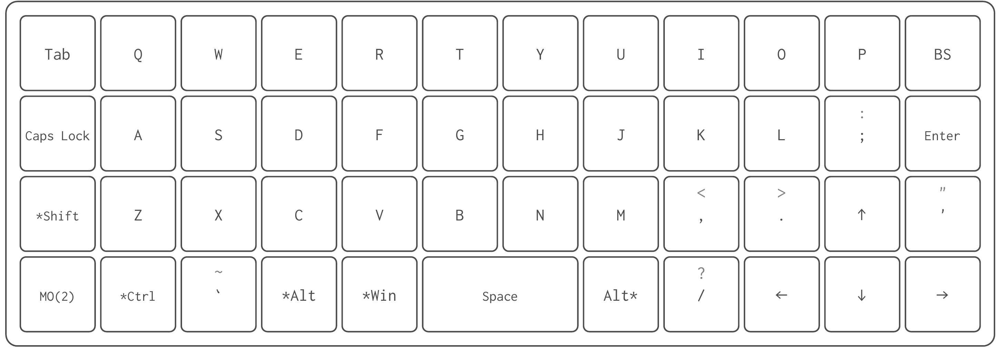
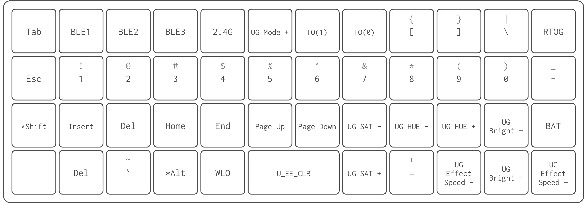
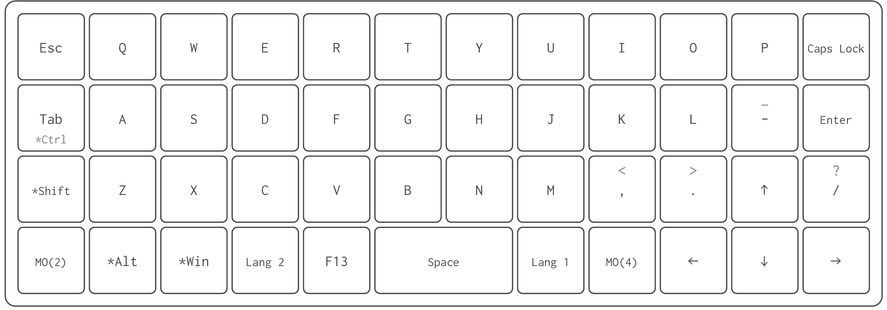
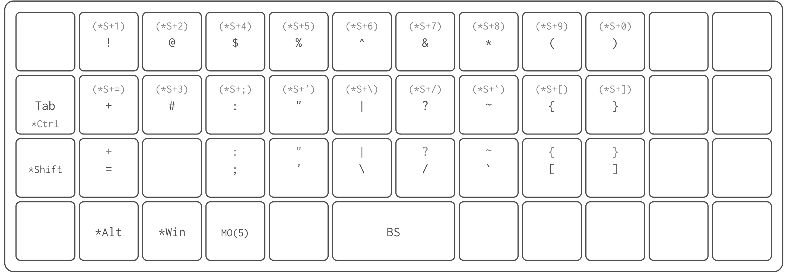
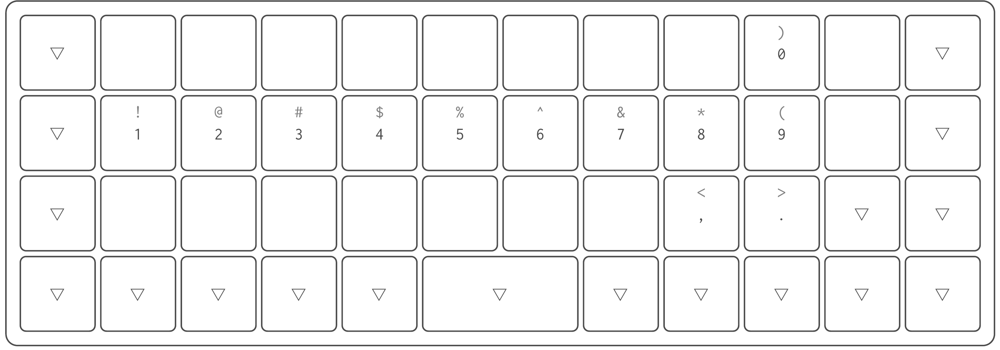

<!-- cSpell:words Epomaker Kailh Luma -->

  
40％キーボード Luma40 を語る

  
宇佐見公輔

# 40％キーボード Luma40 を語る

この記事では、キーボードメーカー Epomaker さんが出している PC 用のキーボード Luma40 を紹介します。

## Luma40 の特徴

まずは外観を紹介します。コンパクトなサイズのキーボードです。Nintendo Switch 向けのケースを流用していますが、ちょうどピッタリおさまっています。

<!-- textlint-disable spellcheck-tech-word -- VFM の幅指定に含まれる CSS の % を全角化する誤検出を避ける -->

{style="width: 75%"}

<!-- textlint-enable spellcheck-tech-word -->

筐体はアルミ製で、キーキャップは半透明です。なお、キーキャップの一部をピンクのものに自前で交換しています。写真ではバックライトはオフですが、オンにするとキーキャップ越しに光が広がります。

公式サイトは<https://epomaker.jp/products/epomaker-luma40>です。外観以外にも多くの特徴が紹介されていますが、この説明を理解するにはキーボードに関する知識が必要になります。そこで、まずはキーワードをピックアップして、必要な知識をひとつずつ説明していきます。

### オーソリニア配列

PC 用のキーボードのキーは、格子状には並んでおらず各キーが斜めにずれている配列が一般的です。たとえば、アルファベットの A キーから見て Q キーは真上ではなく左上に、W キーは右上にあります。この配列はロウスタッガードと呼ばれます。

実はそれ以外の配列のキーボードもあります。次のようなものがあります。

<!-- textlint-disable spellcheck-tech-word -- VFM の幅指定に含まれる CSS の % を全角化する誤検出を避ける -->

{style="width: 85%"}

<!-- textlint-enable spellcheck-tech-word -->

ロウスタッガード配列は、タイプライター時代からずっとある標準的な配列です。それに対してカラムスタッガード配列は、人間の指の長さの違いに合わせた配列です。一方、格子状に整然と並んだオーソリニア配列は、キーボード自体をコンパクトサイズにしやすくなります。

Luma40 はオーソリニア配列となっています。

### 40％キーボード

フルサイズのキーボードは、テンキーを含めると 100 以上のキーがあります。それに対していくつかのキーを省いたものを「⚪︎⚪︎％キーボード」と呼ぶ場合があります。厳密な定義はありませんが、目安としては次のような感じです。

Luma40 は 40％キーボードにあたります。キー数は 47 です。Fn キーを持っており、数字や一部の記号は Fn キーとの組み合わせで入力することになります。

### キーマップのカスタマイズ

キー数が少ないキーボードでは、どのキーに何を割り当てるか（キーマップ）が使い勝手に大きく影響します。そのため多くのキーボードでは、キーマップのカスタマイズ機能があります。これはキーボードに組み込まれたファームウェアによって実現されます。

Luma40 にはファームウェア QMK（<https://qmk.fm>）が組み込まれていて、キーマップのカスタマイズをサポートします。VIA（<https://www.caniusevia.com>）や Remap（<https://remap-keys.app>）といったツールでキーマップを変更できます。

Luma40 のデフォルトのキーマップは次のようになっています。Fn キー（左下の MO（2）キー）がレイヤー切り替えで、たとえば Fn + A でレイヤー 2 にある数字の 1 のキー入力です。

### メカニカルスイッチ

キーボードのキースイッチには、メンブレンスイッチやメカニカルスイッチなどがあります。

メンブレンキーボードは、一枚のシート状のスイッチを使ったキーボードです。キーごとに独立していないため構造が比較的単純で、安価に生産でき多くの PC で採用されています。

メカニカルキーボードは、キーごとに独立したスイッチを使ったキーボードです。スイッチの種類が豊富で、さまざまな打鍵感のキーボードが存在しています。

Luma40 はメカニカルキーボードです。

### ホットスワップ対応

メカニカルキーボードの中でも、はんだ付けをせずにキースイッチを交換できるものはホットスワップ対応と呼ばれます。

Luma40 はホットスワップ対応であるため、好みのキースイッチへの交換がはんだ付けなしで可能です。ただし、メカニカルスイッチには規格がいくつかあり、互換性には注意が必要です。

### ロープロファイル仕様

メカニカルキーボードのキースイッチやキーキャップの高さ・形状の特徴を、プロファイルという言葉であらわします。そのうち、背が低い薄型のものをロープロファイルと呼びます。

Luma40 は、キースイッチとキーキャップの両方がロープロファイル仕様です。キースイッチは Kailh ロープロファイル仕様が採用されています。また、キーキャップは LAK ロープロファイル仕様が採用されています。

### キースイッチの種類

メカニカルスイッチにはさまざまな仕様のものがあります。大きなタイプ分けとして、リニア、タクタイル、クリッキーという分類があります。リニアは押すとなめらかに沈みこむタイプ、タクタイルは押して沈む途中で手応えがあるタイプ、クリッキーは入力でクリック音が鳴るタイプです。

Luma40 に標準搭載されているキースイッチは Kailh White Rain スイッチです。これはリニアに分類されます。ロープロファイル仕様のリニアスイッチの中では、押下ストロークの深さは平均的で、荷重が少し重めのスイッチです。

## Luma40 を語る

ここからは、筆者自身が Luma40 に対してどう感じているかを語っていきます。

### 持ち運びやすいコンパクトさ

いま、在宅勤務とオフィス勤務のハイブリッドな働き方をしています。そのため、カバンに入れて持ち運びやすいキーボードが欲しかったのです。

以前は Happy Hacking Keyboard を使っていました。オフィスや家に据え置きで使っているあいだは満足して使っていたのですが、持ち運ぶ機会が増えてくると、カバンに入れるにはかさばるサイズだと感じました。

そのため、もう少しコンパクトなものを検討し始めました。そんななかで出会ったのが Luma40 でした。いわゆる自作キーボードも考えていましたが、入手が大変だったり組み立てが面倒だったりが気になっていました。Luma40 はメーカー製であるため完成品が簡単に入手できる点が良かったです。

冒頭の写真のように、Nintendo Switch 向けのケースにおさまりました。筆者の手元にたまたま余っていたケースでしたが、あつらえたかのようにフィットしたのは嬉しい点でした。このおかげで、持ち運びが楽になり満足しています。

### オーソリニア配列への慣れ

Luma40 のコンパクトさを実現している要因のひとつがオーソリニア配列です。ロウスタッガード配列からの乗り換えで、最初はやはりキーをタイプする指の感覚が変わるので少しとまどいました。ただ、配列の違いはそれほど大変なことでもなく、使っているうちに自然に慣れていきました。

ただ、納得できていない点もあります。オーソリニア配列の利点として時々見かける話で、運指距離が短くなるため人間工学的に優れているというものがあります。これは今のところ同意できません。確かに上下のキーは近いけども、斜めのキーは遠いわけです。指が楽になったかといわれるとそうでもありません。

一方で、格子状に整然と並んでいるのでキーの位置関係が分かりやすくて、認知負荷が低いと感じています。そのおかげで、キーマップが覚えやすいのです。キーマップのカスタマイズでは、オーソリニア配列であることに助けられています。また、キーがコンパクトに並んでいることが単純に気持ちよいとも感じています。

### 少ないキー数への慣れ

コンパクトさを実現している要因として大きいのが、キー数の少なさです。そして同時に、キーボード乗り換えにあたっての大きなハードルでもあります。筆者はそれまで使っていたのが 60 ％キーボードで、Luma40 ではじめて 40 ％キーボードを使い始めました。

やはり大きいのが、数字キーがないことでした。数字がひとつのキーで打鍵できないのは、想像以上にストレスを感じました。だんだん慣れてはきたものの、今でもまだ数字を打ちづらい気持ちはあります。その一方で、数字キーの列が一段減っているのは恩恵として感じます。指を大きく上に動かす必要がないので、指が楽になっています。

また、記号キーが減っているのも影響はありました。日々のコーディングで記号はよく使うので、最初はとまどいました。ただ、こちらは意外とすぐに慣れました。もともと記号類は Shift キーを押しながら入力することも多かったわけで、複数のキーの組み合わせで記号を入力することにはさほど心理的な負担はありませんでした。キーマップをカスタマイズして、どの記号をどこに置くかを考えるのが案外楽しい作業でした。キーマップについては後のセクションで改めて述べます。

キーボードの横幅が短くなり、人によってはホームポジションを崩さずに無理なく打鍵できる幅のようです。もっとも、筆者はホームポジションを守っていません。小指をほとんど使わずに四本指で打鍵している都合で、ホームポジションはいつも崩れています。それでも、手を動かす距離が短くなっているのは楽になったと感じます。

### 打鍵感

いくら持ち運びやすいといっても、快適なキーボードでなければ持ち運ぶ意味がありません。ノート PC のキーボードのほうが快適なら、そもそも外付けキーボード自体が不要なわけです。

筆者にとっての快適さはいくつかありますが、打鍵感は大きなポイントだと考えています。打鍵感が好みとあわないと、タイピングが遅くなったりタイプミスが増えたりします。筆者はノート PC のキーボードはあまり好みがあいません。とくに押下ストロークが浅いのはつらいところです。

Luma40 はロープロファイル仕様のため、ノート PC ほどではありませんが、押下ストロークは浅めではあります。ただ実際に使ってみると、それほど浅すぎるとは感じませんでした。Kailh White Rain スイッチの荷重が重めなのも押下感の向上につながっていそうで、好みです。打鍵音も悪くないと思っています。そのため、キースイッチの交換はせずに標準のまま使っています。

## キーマップを語る

筆者が使っているキーマップを紹介します。なお、レイヤー 1、2、3 はデフォルトのままです。

この筆者のキーマップについて、いくつか説明していきます。

### Tab と Ctrl

キーマップのカスタマイズ機能には、Mod-Tap という設定があります。同じキーの単押しと長押しで異なるキーを割り当てる設定です。単押しでは通常のキー、長押しでは Ctrl などの修飾キー、という設定ができます。

これを利用して、Tab キーと Ctrl キーは同じキーに割り当てています。単押しだと Tab、長押しだと Ctrl です。このおかげで左端の 4 つのキーに、Esc、Tab、Ctrl、Shift、Fn の 5 つの機能を入れることができます。

### 日本語入力のためのキー

スペースキーの左右に Lang 1（かな）と Lang 2（英数）を置いています。日本語入力のオンとオフのキーであり、筆者が頻繁に使うキーです。さらに、F13 キーがあります。筆者は日本語入力ソフトにかわせみ 4 を使っており、日本語入力の確定キーをカスタマイズして F13 に設定しています。

日本語入力の確定キーについては筆者のこだわりがあります。多くの場合、日本語入力の確定は Enter キーが使われています。しかし Enter キーはすでに、改行機能と、実行機能（メッセージの送信実行など）の役割を持っています。チャットアプリなどで、日本語入力の確定のつもりで誤って書きかけのメッセージを送信してしまう、という問題を聞くことがあります。それは実のところ、 Enter キーに日本語入力の確定の役割を持たせていることがおかしいと筆者は考えています。そのため、筆者は日本語入力の確定を Enter ではなく別のキーに設定しています。

### 記号レイヤー

MO（4）を押しながらキーを押すとレイヤー 4 の入力になります。ここは記号のレイヤーです。

配置の特徴として、いくつかのキーは Shift キーも押された状態にしています。たとえば、Q キーの位置にはレイヤー 4 では`!`を配置しています。これは実際の設定としては`Shift + 1`の入力を設定してあります。すでに MO（4）キー長押しの状態なので、そこからさらに Shift キーの長押しまでは必要ないようにしてあるわけです。

### Backspace キー

Backspace キーの位置変更は、キーマップのカスタマイズの定番のひとつのようです。通常のキーボードでは右上にありますが、頻繁に使うわりには遠い位置にありますし、Enter キーとの誤打鍵も気になります。

筆者は MO（4）＋スペースキーに割り当てています。

### 数字レイヤー

レイヤー 4 に MO（5）キーを配置しています。MO（4）を押しながら MO（5）キーを押してレイヤー 5 の入力になります。ここは数字のレイヤーです。

たとえば、`1`を入力するには、MO（4）＋MO（5）＋A と 3 つのキーを使います。

ここは実のところ、苦肉の策という感じです。数字レイヤーへの切り替えキーを専用でひとつ用意したい気持ちがあるのですが、実現できていません。まあ、両方の親指で押しながらというのも慣れればいけるな、ということで今は落ち着いています。

数字キーはデフォルト設定のレイヤー 2 にも配置されていて、それを使うこともできます。普段使いするには押しづらい位置ですが、場合によってはそちらも使っています。

## 終わりに

Luma40 について語りました。コンパクトなキーボードが欲しかっただけなのに、気づいたらキーボード沼にはまってしまっていた感じがします。

次は左右分割キーボードに手を出しそうです。これまでは左右分割には興味がなかったのですが、いつのまにか興味が出てきてしまいました。不思議ですね。まあいろいろ試してみようとは考えています。
